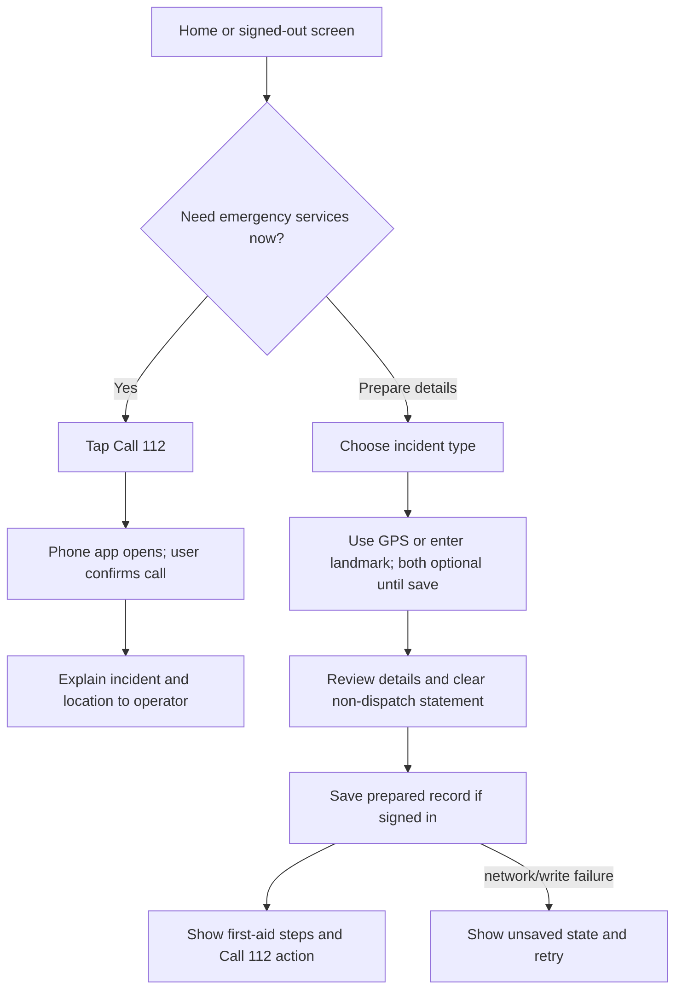

# EM3RGENSY product and system blueprint

**Status:** design proposal for the next implementation stages  
**Grounding:** current repository audit, `README.md`, Flutter client, Firestore rules, Cloud Functions, and Render configuration. This document separates implemented behavior from proposed behavior; it does not claim external emergency, hospital, ambulance, ABDM, document-storage, or caregiver integrations are live.

## 1. Product requirements and MVP boundary

### Product outcome

Help a patient prepare before an emergency, take a safe next step during one, share a concise and consented medical handover with a real care partner when available, and keep recovery tasks organized afterwards.

The product's trust boundary is explicit: the app can help the patient call 112 and prepare information; it cannot dispatch responders, guarantee hospital capacity, or claim that a partner received an incident unless a verified integration confirms it.

### Users and roles

| Role | Current support | Intended responsibility |
|---|---|---|
| Patient | Firebase email/password account; own profile, requests, reminders | Own identity, consent, emergency details and recovery record |
| Doctor | Facility-scoped custom claim and appointment workspace | Review requests for the assigned facility; no general patient-record access |
| Caregiver/family | Owner-managed family profile data in the patient's profile | Future invited identity with patient-granted, revocable scopes |
| Ambulance operator | None | Future verified partner identity; accept/decline and report confirmed status |
| Hospital administrator | None | Future verified facility staff; manage only their facility and scoped handovers |
| Platform administrator | Privileged Firebase/operator scripts only | Limited operational administration with auditable actions |
| Community organization | None | Future organization verification and request fulfillment |

### MVP requirements

1. Make calling 112 immediately available. Keep it separate from incident preparation and clearly state that a call is not initiated until the user confirms it in their phone app.
2. Let a signed-in patient prepare an incident with type, optional details, GPS or manual location, timestamp, and `prepared` state. Keep retries idempotent and never label it dispatched.
3. Provide an owner-controlled emergency passport and a QR that reveals only selected fields, with a plain warning that a static QR can be copied and cannot be revoked after copying.
4. Provide a first-aid reference that prioritizes emergency services, is medically reviewed before release, and works offline as bundled content.
5. Show nearby OpenStreetMap listings as unverified map results, with source and data freshness. Do not imply current ED capacity.
6. Keep appointments and labs as user requests until an actual provider contract and integration exist.
7. Add authenticated, consent-scoped caregiver access only after an invitation and authorization model is implemented in backend rules/functions. An in-profile checkbox alone is not delegated access.

### Explicitly out of MVP until a partner exists

Ambulance dispatch and tracking; 112 incident submission; hospital capacity; clinical handover receipt; provider appointment confirmation; diagnostic result ingestion; ABHA/ABDM exchange; verified donor coordination; autonomous clinical decision support. These need partner authorization, operational processes, privacy review, and integration tests.

## 2. Architecture

### Architecture decision

Retain the current Flutter + Firebase architecture for the pilot. Do not migrate to React, NestJS, PostgreSQL, Redis, or a new cloud solely to match a generic target stack. Firebase already provides the app's auth, user-scoped records, callable server functions, push plumbing, and static web deployment. Create clear domain boundaries in the existing client and Functions code. Revisit a relational service only when partner workflows, reporting, transactional constraints, or interoperability needs exceed Firestore's fit and the team can operate the new service.

### Current and proposed components

```mermaid
flowchart LR
  Patient[Flutter patient app<br/>Android · iOS · Web]
  Doctor[Flutter doctor workspace]
  Auth[Firebase Authentication]
  Check[Firebase App Check]
  Rules[Firestore Security Rules]
  DB[(Cloud Firestore<br/>asia-south1]
  Fn[Cloud Functions v2<br/>asia-south1]
  AI[Firebase AI Logic / Vertex AI]
  FCM[Firebase Cloud Messaging]
  Map[OpenStreetMap<br/>Nominatim · Overpass]
  Render[Render Docker + Nginx<br/>Flutter web]
  Partner[Future verified partners<br/>hospital · ambulance · lab]

  Patient --> Auth
  Doctor --> Auth
  Patient --> Check
  Doctor --> Check
  Patient --> Rules
  Doctor --> Rules
  Rules --> DB
  Patient --> Fn
  Doctor --> Fn
  Fn --> DB
  Fn --> AI
  Fn --> FCM
  Patient --> Map
  Render --> Patient
  Fn -. future authenticated adapters .-> Partner
```

**Current:** Render serves static Flutter web; it is not the backend. Auth, Firestore and Functions are Firebase. The client calls Firebase AI Logic for live voice; the report explainer uses Vertex AI in a Function. Hospital search calls public map/geocoding endpoints. FCM sends a notification when a server-created lab result exists and the user has a saved token.

**Proposed boundary:** add domain service/repository modules for `passport`, `incidents`, `care-circle`, `handover`, `recovery`, `documents`, and `partners`. Put all partner credentials and privileged operations in Functions or a later server, never in Flutter. Partner adapters must expose explicit states such as `not_configured`, `requested`, `accepted`, `declined`, `failed`, and `confirmed`; mock adapters must be labelled test-only and never displayed as live dispatch.

### Trust boundaries

- Patient clients may read and change only their own allowed patient data. Sensitive fields are minimized at write boundaries and never placed in public facility documents.
- Trusted clinical result, doctor role, incident dispatch, partner acceptance, and hospital verification fields are server-only.
- Doctor custom claims scope access to a facility. Future staff roles should use verified claims and backend checks, not a `role` value in the user profile.
- Caregiver access should be represented by a separate relationship/grant record and checked on every read and write. Revocation must be effective in rules or callable service checks, not merely hidden in the UI.
- QR is a bearer disclosure with no authentication. Encode only patient-approved minimum data; no document URLs, account IDs, or access tokens.
- External AI receives only the minimum fields required after explicit, purpose-specific consent. No voice transcript or medical history should be silently attached to a model request.

## 3. Data model (Firestore pilot)

Firestore is document-oriented; the schema below defines document IDs, fields, ownership and validation instead of claiming relational foreign keys or SQL migrations. Use server timestamps, immutable audit event IDs, bounded strings/arrays, and explicit schema versions. Add composite indexes only for actual list queries. All sensitive documents inherit UID ownership unless an explicit grant is implemented.

### Collections and document shapes

| Path | Document / key fields | Write authority and validation |
|---|---|---|
| `users/{uid}` | `schemaVersion`, `displayName`, `locale`, `createdAt`, `updatedAt`, `emergencyContactName`, `emergencyContactPhone`, `preferredHospitalId`, `fcmToken` | Owner; restrict keys, type/length and mutable fields. Never store trusted role here. FCM token is private and should be independently constrained. |
| `users/{uid}/passport/current` | **Implemented first version:** `schemaVersion`, blood group, height/weight, allergies, conditions, medications, one emergency contact, preferred hospital, per-field QR consents, `updatedAt` | Owner reads/writes only; Firestore rules bound keys and value sizes. Health values are patient-reported; there are no verified fields. Legacy profile values are read/mirrored during transition. The passport screen owns detail editing and QR consent/preview. |
| `users/{uid}/consents/{consentId}` *(proposed)* | `purpose`, `recipientType`, `recipientId`, `scopes[]`, `grantedAt`, `expiresAt`, `revokedAt`, `version` | Owner grants/revokes; server validates recipient and allowed scopes. No blanket consent. |
| `users/{uid}/alerts/{incidentId}` | Current fields: `type`, `situation`, `reason`, `location`, `latitude`, `longitude`, `status`, `createdAt` | Owner can create a bounded incident in `prepared`; cannot claim partner acceptance or edit status. Use generated random ID + idempotency key; backend-owned state transitions later. |
| `incidents/{incidentId}` *(proposed server projection)* | `patientUid`, `createdAt`, `incidentType`, `location`, `reportedDetails`, `state`, `partnerId?`, `stateUpdatedAt` | Server create/update only; patient and explicitly assigned partner get limited reads. Separate public-safe incident state from sensitive passport. |
| `incidents/{incidentId}/events/{eventId}` *(proposed)* | `type`, `fromState`, `toState`, `actorType`, `actorId`, `occurredAt`, `source`, `idempotencyKey` | Server append-only; supports duplicate protection and incident timeline. Do not include unnecessary clinical payload in logs. |
| `users/{uid}/appointments/{id}` and `appointments/{id}` | Existing request fields include patient UID, mode, doctor/specialty, date/slot, reason, optional facility, status, createdAt | Patient creates validated `requested` request. Doctor callable can review only same-facility request. Provider-confirmed status must be a separate verified integration outcome. |
| `users/{uid}/labBookings/{id}` | Existing client request fields and `createdAt` | Owner read/create today; bound fields and make provider state explicit only when integrated. |
| `users/{uid}/labResults/{id}` | `testName`, `value`, `unit`, `referenceRange`, `status`, `observedAt`, `source`, `aiSummary?` | Trusted server/admin write, owner read. AI summary requires consent. Never permit patient to author a result as a verified lab value. |
| `users/{uid}/documents/{documentId}` *(future)* | `objectPath`, `category`, `contentType`, `sizeBytes`, `checksum`, `createdAt`, `source`, `consentScopes` | Metadata server-validated; object access via short-lived authorized flow and per-owner Storage rules. Reject unapproved MIME types, size excess and executable content. No current uploads. |
| `users/{uid}/careCircle/{memberUid}` *(future; replaces embedded family list)* | `relationship`, `state`, `scopes[]`, `invitedAt`, `acceptedAt`, `expiresAt`, `revokedAt` | Both parties bind invitation; patient controls scopes. Check consent on each operation. Do not store another person's medical record in the inviter's profile. |
| `users/{uid}/recovery/{recordId}` *(future)* | `kind`, `title`, `dueAt?`, `status`, `source`, `clinicianInstructions?`, `createdAt`, `updatedAt` | Owner record; reminders are administrative prompts, not medical instructions. Clinical instructions retain provenance and are not generated by AI. |
| `facilities/{facilityId}` *(proposed)* | verified public name/address/contact, `verificationState`, `verifiedAt`, `services[]`, `source`, `updatedAt` | Verified operator/admin only. Map listings remain in a separate unverified source model. |
| `facilities/{facilityId}/availability/{slotId}` | Existing doctor-published date, slot, status | Facility claim writes; only public-safe fields readable. Record freshness/expiry; stale slots are not presented as confirmed availability. |
| `doctorInvites/{hash}` | Existing hashed invite code, facility, active state | Admin script/server only. Never return invite hash or private invite metadata to ordinary clients. |
| `auditEvents/{eventId}` *(future)* | `actorUid`, `action`, `resourceType`, `resourceId`, `time`, `outcome`, minimal `requestId` | Server append-only; exclude tokens, raw medical records and full coordinates. Restrict audit access to designated operators. |

### Indexing, retention, consistency

- Keep current per-user subcollections queryable by `createdAt` and incident chronology. Add an index for `facilityId + status + createdAt` for a facility queue if query execution requires it.
- Do not duplicate a medical payload into global query collections. Where a denormalized operational projection is necessary, store only identifiers and minimum workflow fields and document its source of truth.
- Treat request IDs and event IDs as idempotency controls. A repeated client submit must not create multiple incidents or partner requests.
- Define retention/deletion rules with product, security and counsel before collecting documents or dispatch records. Backups, exports and audit retention need a separate policy; deletion of a screen record does not imply deletion from backups.
- No sample patient records are included here. Use generated synthetic development fixtures, visibly marked as synthetic, in a future emulator suite.

### State model

`prepared` means the patient prepared information in the app. If a real partner adapter is later authorized, use a separate transition flow such as `request_submitted -> partner_acknowledged -> accepted -> dispatch_confirmed -> patient_picked_up -> hospital_reached`, with terminal `declined`, `cancelled`, `timed_out`, and `failed` states. Each transition is server-authenticated, partner-attributed, timestamped, append-only, and validated against the prior state. A timeout never becomes `accepted` or `dispatch_confirmed`.

## 4. Core user journeys

### Patient: emergency



The direct 112 action is implemented on signed-out and signed-in home surfaces. It delegates to the device's phone app; platform confirmation and call completion are outside app control. No emergency contact is automatically notified today.

### Patient: passport and QR

Patient edits self-reported emergency fields -> chooses per-field QR disclosure -> previews exactly what is encoded -> acknowledges that any scanner can retain a copy -> displays or shares the QR. Future verified data must show verifier/source and time; it must not overwrite patient-reported content silently.

### Doctor: appointment request

Patient creates a request -> request is visible only to its patient and doctors whose verified claim matches the selected facility -> doctor callable validates same facility and current request state -> transaction records accept/decline and books the slot if applicable -> patient sees request outcome. It is not a hospital appointment until the facility's real workflow confirms it.

### Future caregiver: consent lifecycle

Patient selects caregiver and precise scopes -> invitation is sent using an authorized channel -> caregiver authenticates and accepts -> backend binds identities and grant expiry -> every read checks grant and scope -> patient revokes or grant expires -> access is denied immediately and access event is audited. No invitation/notification channel is currently implemented.

### Future handover

Patient previews a timestamped summary and its sources -> selects a verified receiving facility/clinician -> backend issues narrowly scoped, expiring access -> receiver authenticates and acknowledges receipt -> acknowledgement records identity/time without implying diagnosis or treatment -> patient can revoke remaining access. No such handover integration currently exists.

## 5. API and integration contracts

The current client uses Firebase SDK operations and callable Functions, not a REST service with OpenAPI. Keep those interfaces for the pilot; publish a versioned OpenAPI document if a partner REST API is commissioned. Every callable must require authentication as appropriate, validate payload size/type, enforce App Check where supported, check authorization server-side, use stable error codes, and be idempotent for workflow mutations.

| Operation | Current interface | Access and important response |
|---|---|---|
| Sign in/register/reset | Firebase Auth SDK | User's Auth identity; doctor role is resolved from verified token claims. |
| Create prepared SOS | Firestore `users/{uid}/alerts/{id}` create | Owner only; `prepared`; no dispatch claim. |
| Create appointment request | Firestore batch to global and user subcollection | Signed-in owner; `requested`; global record is visible to patient and matching facility doctor. |
| Review appointment | Callable `reviewAppointment` | Doctor claim and matching facility; request transitions to `approved` or `declined`, availability transactionally booked when applicable. |
| Redeem doctor invite | Callables `validateDoctorInvite`, `redeemDoctorInvite` | Invite validation; redemption requires auth, bounded doctor name; server assigns claims. |
| Explain lab result | Callable `summarizeLabResult` | Authenticated owner, consent record and own result required; educational summary only. |
| Publish availability | Firestore facility availability | Matching doctor claim; currently self-published data, not live hospital availability. |

### Future partner interface (proposal, not implemented)

Use an authenticated server-to-server adapter, never a client claim of success:

- `POST /v1/incidents` -> `202 {incidentId, state:"request_submitted", createdAt}` only after partner API acceptance of the request envelope; otherwise return a typed failure and keep app status unconfirmed.
- `GET /v1/incidents/{incidentId}` -> authorized minimal state projection with `state`, `stateUpdatedAt`, `sourcePartner`, and event history.
- `POST /v1/incidents/{incidentId}/cancel` -> cancellation requested/confirmed as separate states; cannot erase dispatched event history.
- Partner webhook -> signature verification, replay protection, idempotency key, schema validation, allowed-state transition, audit event, then patient notification.

Before using a real service, document partner identity, contract, test/sandbox endpoint, authentication, retry/backoff, timeouts, data minimization, operational escalation and failure semantics. Do not ship invented credentials or mock successes.

## 6. Privacy, security and assurance gates

1. Replace broad profile writes with field-level allowlists and bounded values before adding more health data. The passport subdocument already uses a dedicated bounded schema.
2. Add Firestore Emulator rules tests for cross-user reads, patient role escalation, forged verified result/incident state, facility boundary, caregiver consent expiry/revocation and overlarge writes.
3. Keep `storage.rules` deny-all until a document upload design exists; then use private per-user paths, content validation, least privilege, and expiring access.
4. Verify App Check providers/enforcement, Firebase Auth domains, API restrictions, Functions IAM, backup/retention and logging from the live consoles before pilot. Repository inspection cannot verify them.
5. Threat-model abuse cases: false emergency spam, duplicate submissions, malicious QR readers, leaked caregiver access, stolen device, document exfiltration, doctor account compromise, replayed partner webhook, and denial of service.
6. Obtain qualified privacy/legal review for applicable Indian privacy obligations and official ABDM/ABHA requirements before making compliance or interoperability claims. No certification or ABDM integration is claimed here.
7. Obtain clinical review and versioned approval for first-aid text and translated content. AI output is supplementary, never an emergency procedure authority.

## 7. Milestone implementation plan

| Milestone | Deliverable | Exit criteria |
|---|---|---|
| 0. Stabilize current repo | Flutter toolchain works; dependency/analyzer/test/release build baseline recorded; Firebase rules test harness | CI or repeatable local commands pass; existing SOS and auth regressions covered |
| 1. Emergency access and passport foundation | One-tap 112 (implemented); schema validation; incident idempotency; offline essential emergency card | No sign-in/location dependency for dial; no false dispatch copy; airplane-mode read tested; cross-user rules tests pass |
| 2. Passport and readiness | Separate versioned passport data, source/timestamp labels, missing-field checklist, safe QR preview | Owner-only access, QR disclosure tests, verified/self-reported values distinguished |
| 3. Hospital discovery reliability | Source labels, contact/directions where present, cache last successful results, freshness, service tags only when supplied | Offline/stale states truthful; listings never represented as verified partner capacity |
| 4. Consent-based care circle | Separate invitation and grant documents, scopes, expiry/revocation, notification | Emulator proof of denial after revoke; no profile-copy authorization |
| 5. Recovery timeline and reminders | Provenance-aware records, local notification design, opt-in reminders | User distinguishes clinician instructions from app reminders; notification permission/reboot behavior tested |
| 6. Language bridge | English, Hindi, Kannada localization for nav/emergency content; original + translated confirmation for critical text | Clinically reviewed translations, locale tests and accessible text sizing |
| 7. Documents and handover | Private storage flow and patient-generated structured handover | Consent, expiring access, file validation, receiver acknowledgement; no autonomous diagnosis |
| 8. Partner pilot | One authorized partner sandbox and documented adapter | Partner confirms sandbox scenarios; failure/timeout/duplicate tests; operational support ready |
| 9. Controlled pilot | Small invited user group, incident reporting and on-call ownership | Security/privacy/clinical review complete; rollback and incident response exercised |

Do not begin a second major module until the prior milestone's exit criteria pass. In particular, do not spend on live ambulance/hospital claims until a partner agreement and sandbox exist.

## 8. Immediate next engineering tasks

1. Restore Flutter CLI execution and record `flutter pub get`, `flutter analyze`, `flutter test`, and `flutter build web --release` results. The recent direct 112 widget test is written but has not run.
2. Add emulator tests for the existing Firestore rules before expanding schemas.
3. Split the monolithic `users/{uid}` profile document into versioned passport, care-circle and recovery subcollections with a compatible migration/read fallback; tighten rules in the same change.
4. Add local, read-only emergency passport cache with secure storage decision and explicit stale timestamp; do not cache session tokens in exported QR/document data.
5. Replace profile checkbox-only family representation with a consent/invitation lifecycle before claiming caregiver sharing.

